# English Listening

Practise English listening by dictation from any YouTube video with captions.

Website: https://betterme.site/

Usage guide: https://betterme.site/usage.html

Examples:

- [Hot Deploying Low-Latency Services for 24/7 Operation • Martin Thompson • YOW! 2022](https://betterme.site/?v=_KvFapRkR9I)
- [Aeron: Open-source high-performance messaging by Martin Thompson](https://betterme.site/?v=tM4YskS94b0)

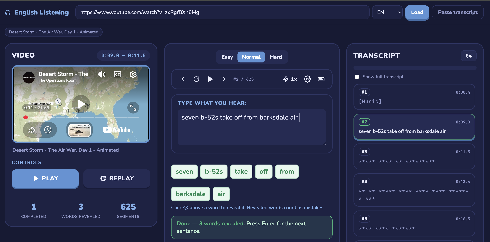

## Usage

### 1. Load a video

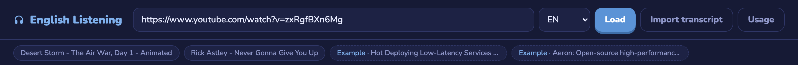

- Paste a YouTube URL, pick the caption language (**EN**, **EN-US**, **EN-GB**) and click **Load**.
- **Import transcript** opens the import dialog (see [Import a transcript](#5-import-a-transcript)).
- **Usage** opens this guide in the app: https://betterme.site/usage.html
- Videos you opened recently show up as chips under the bar, followed by **Example** videos to try. Click one to load it.

### 2. Video

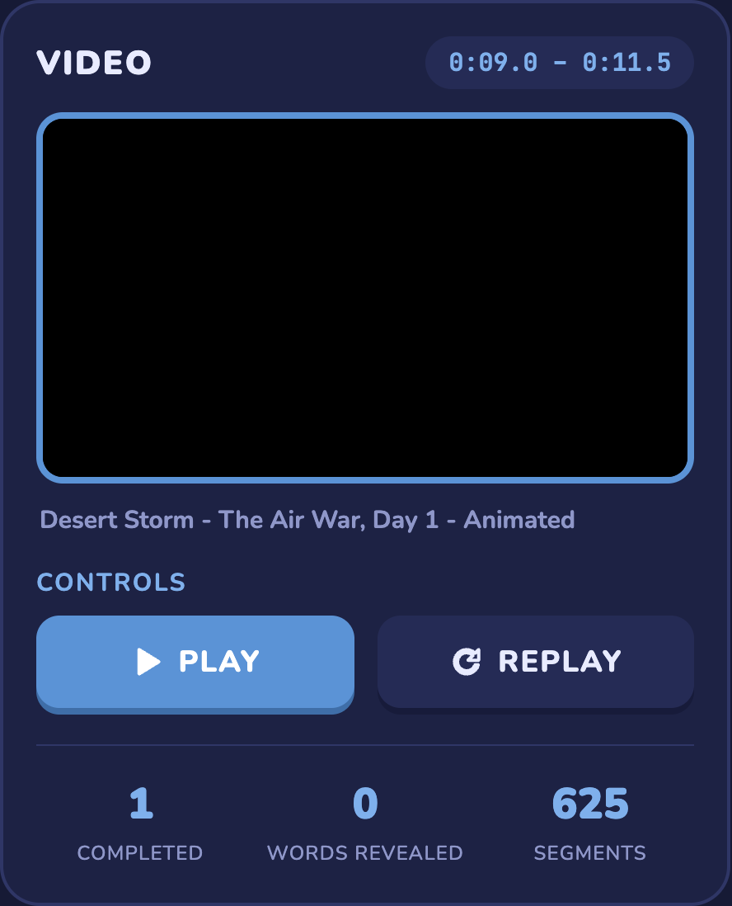

- The pill at the top shows the time range of the current segment.
- **Play** plays the current segment, which stops by itself at the end. **Replay** plays it again from the start.
- The stats show how many segments you **completed**, how many **words you revealed** and the total number of **segments**.

### 3. Dictation

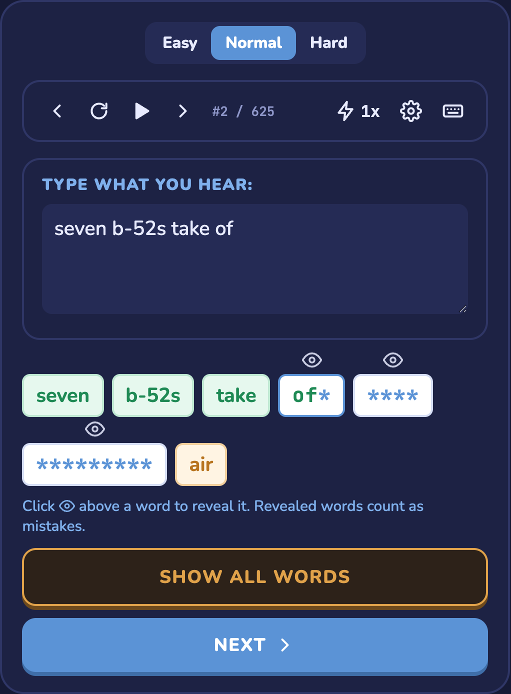

- **Easy / Normal / Hard** sets how much of each hidden word you see. **Hard** doesn't show how long the words are.
- Toolbar: previous segment, replay, play / pause, next segment, the segment counter, playback speed (0.5x → 1.25x), [settings](#settings) and [keyboard shortcuts](#keyboard-shortcuts).
- Type what you hear in **Type what you hear**. The word boxes check your answer as you type:
  - green: correct word
  - letters you typed right stay visible, wrong or missing letters show as `*`
  - orange: a word you revealed
- Click 👁 above a word to reveal it. Revealed words count as mistakes.
- **Show all words** reveals the whole segment. **Next** moves on to the next segment.

### 4. Transcript

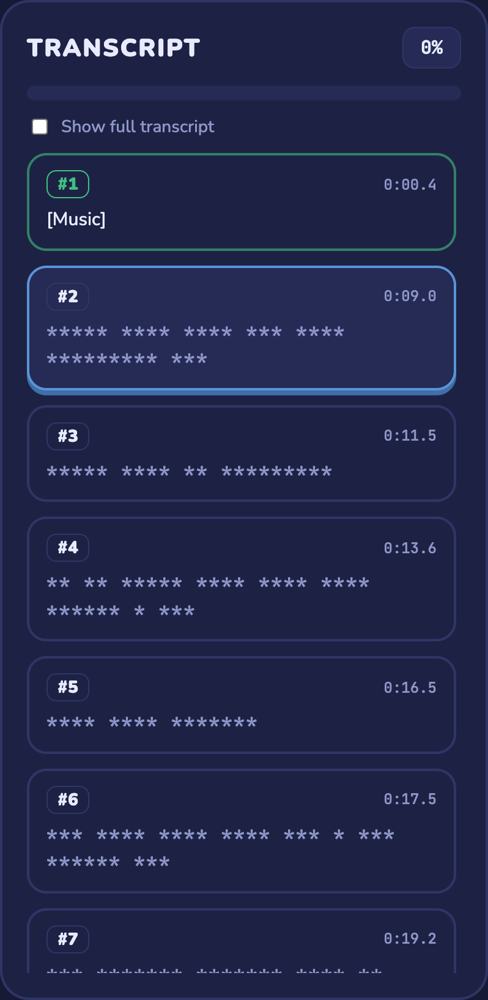

- The progress bar and percentage show how much of the video you finished.
- Each card is one segment. Click a card to jump to it. Completed segments are green and the current one is blue.
- Text you haven't solved is hidden. Tick **Show full transcript** to see everything.

### 5. Import a transcript

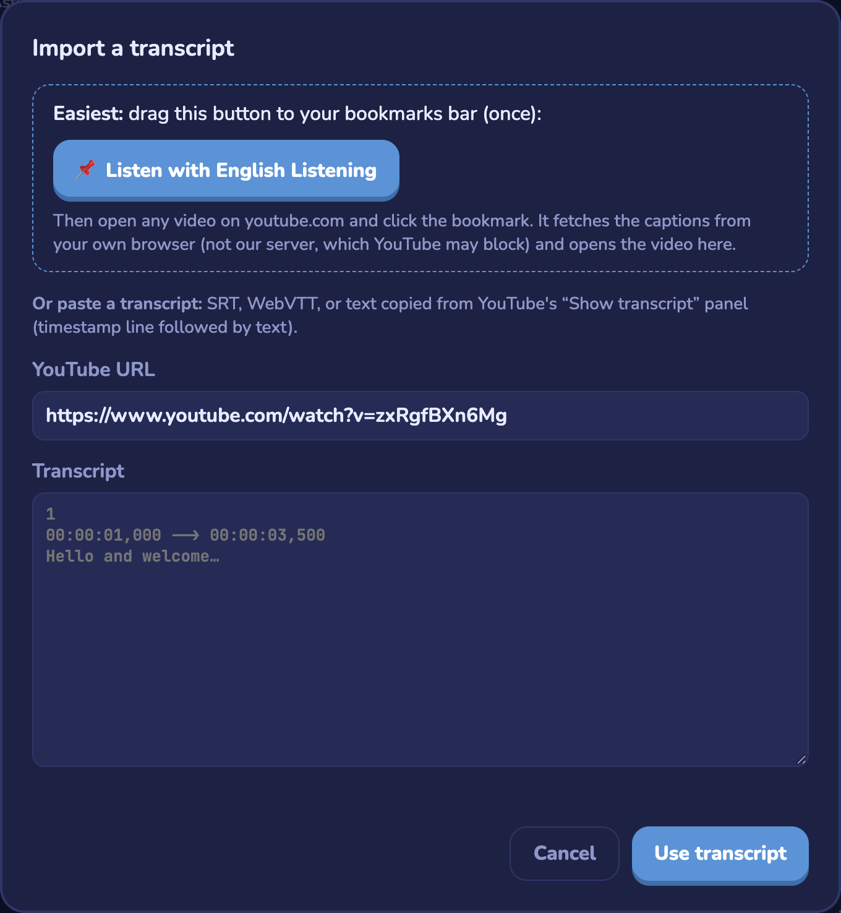

- Drag **📌 Listen with English Listening** to your bookmarks bar, then click it on any youtube.com video page (see [IP got blocked?](#ip-got-blocked)).
- Or paste the YouTube URL and an SRT, WebVTT or YouTube "Show transcript" text, then click **Use transcript**.

### Settings

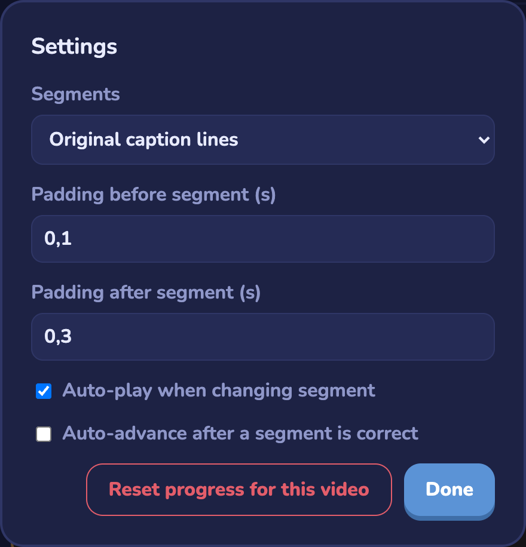

- **Segments**: practise the original caption lines, or merge them into whole sentences.
- **Padding before / after segment**: extra seconds played before and after each segment.
- **Auto-play when changing segment** / **Auto-advance after a segment is correct**.
- **Reset progress for this video** clears your progress for the current video.

Settings and progress are saved in your browser (localStorage).

### Keyboard shortcuts

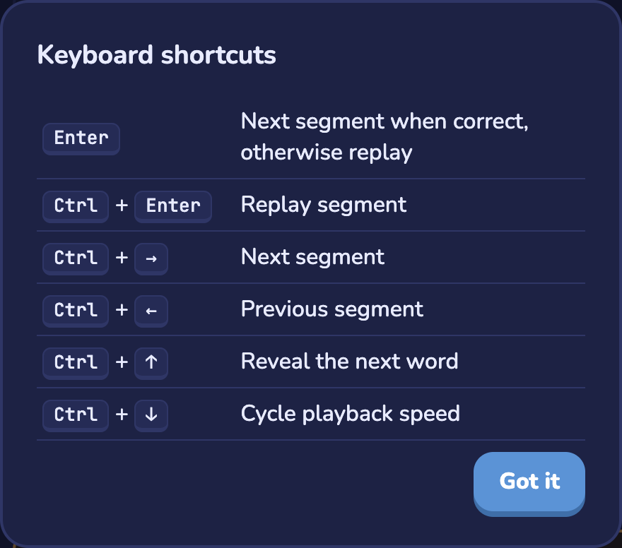

| Keys | Action |
| --- | --- |
| `Enter` | Next segment when correct, otherwise replay |
| `Ctrl` + `Enter` | Replay segment |
| `Ctrl` + `→` / `Ctrl` + `←` | Next / previous segment |
| `Ctrl` + `↑` | Reveal the next word |
| `Ctrl` + `↓` | Cycle playback speed |

## IP got blocked?

When got this
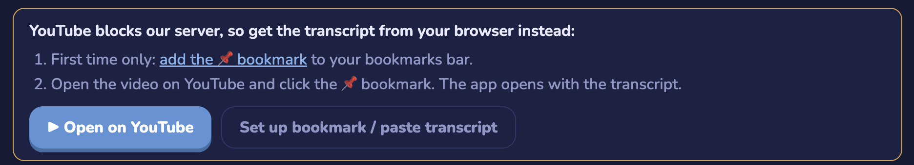

Drag and drop this button into the bookmark of the browser
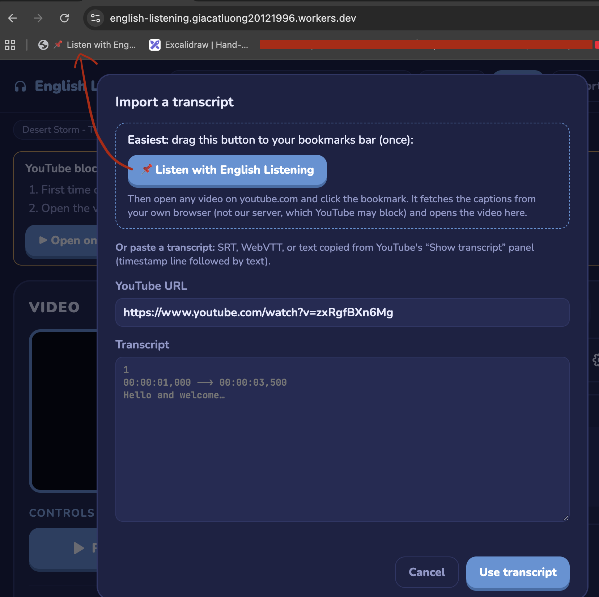

Open the youtube link, then click the bookmarked
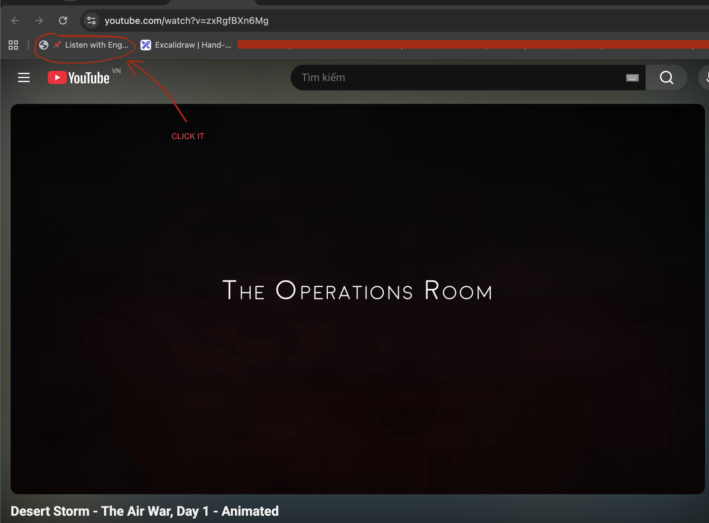

## DEV

Requires Node.js 20+.

### Locally (Node)

```bash
npm install
npm start          # http://localhost:3000
npm run dev        # same, restarts on file changes
```

Use another port with `PORT=4000 npm start`.

### Locally on the Workers runtime

```bash
npm run cf:dev     # http://localhost:8787
```

### Deploy to a VPS (DigitalOcean)

`.github/workflows/deploy-vps.yml` deploys on every push to `main` (or manually from the Actions tab): it SSHes into the droplet, pulls `main`, runs `npm ci` and restarts the app with [pm2](https://pm2.keymetrics.io/).

One-time setup on the droplet:

```bash
# Node 20+ and pm2
curl -fsSL https://deb.nodesource.com/setup_22.x | sudo bash - && sudo apt-get install -y nodejs
sudo npm install -g pm2
pm2 startup   # run the command it prints, so the app comes back after a reboot

git clone https://github.com/gc-garcol/english-listening.git ~/english-listening
cd ~/english-listening && npm ci --omit=dev
PORT=3000 pm2 start server.js --name english-listening && pm2 save
```

Create an SSH key for GitHub Actions and allow it on the droplet:

```bash
ssh-keygen -t ed25519 -f deploy_key -N ""         # on your machine
ssh-copy-id -i deploy_key.pub <user>@<droplet-ip>
```

Then create an environment named `digital-ocean` (Settings → Environments) and add these secrets to it (host, user, port and app dir can also be variables):

| Secret | Value |
| --- | --- |
| `VPS_HOST` | droplet IP or hostname |
| `VPS_USER` | SSH user (e.g. `root` or `deploy`) |
| `VPS_SSH_KEY` | contents of `deploy_key` (the private key) |
| `VPS_PASSWORD` | the user's SSH password — only if you don't use `VPS_SSH_KEY` |
| `VPS_PORT` | optional, defaults to `22` |
| `VPS_APP_DIR` | optional absolute path (e.g. `/root/english-listening`), defaults to `$HOME/english-listening` |

The app listens on port 3000; put nginx (or Caddy) in front of it for a domain and HTTPS. Like other cloud servers, a droplet's IP may be blocked by YouTube; the bookmarklet still works.

### Deploy to Cloudflare Workers

```bash
npx wrangler login # once, opens the browser
npm run deploy     # → https://english-listening.<your-subdomain>.workers.dev
```

## "Sign in to confirm you're not a bot"

YouTube blocks caption requests from cloud servers (Cloudflare, Vercel, …). Use the bookmarklet instead:

1. In the app, click **Import transcript** and drag the **📌 Listen with English Listening** button to your bookmarks bar.
2. Open any video on youtube.com and click the bookmark.

It fetches the captions from your own browser and opens the video in the app. Imported transcripts are saved in
localStorage, so the video works offline from then on. You can also paste SRT / VTT / YouTube "Show transcript" text.
